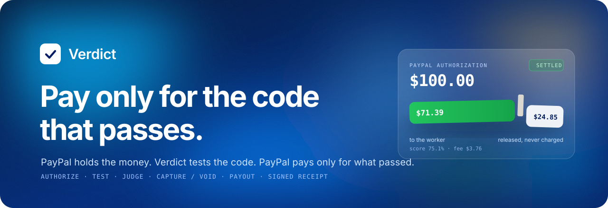

<p align="center">
  
</p>

<p align="center">
  <a href="https://verdict-web-z4k7.onrender.com"><b>Try the app</b></a> ·
  <a href="https://verdict-site.onrender.com"><b>How it works</b></a> ·
  <a href="https://verdict-api-zyaa.onrender.com/docs"><b>API docs</b></a> ·
  <a href="docs/DEMO_SCRIPT.md"><b>Demo script</b></a>
</p>

<p align="center">
  
  
  
  
  
  
  
  
</p>

---

**Verdict** is a pay-on-verification service for software work. A buyer posts a coding job and
PayPal **holds** the budget. A worker, a person or an AI agent, submits code. Verdict runs that
code in an isolated sandbox against hidden tests and inputs nobody has seen, has an AI look for
cheating, and then tells PayPal to **capture exactly the share the work earned**, release the rest
to the buyer, and pay the worker. Both sides get a signed receipt.

> PayPal holds the money. Verdict holds the code. Neither side can run off with the other's half.

## The problem

Every small software deal between strangers starts with the same question: **who pays first?**

- **The buyer pays first** and may get broken, half-done or no code at all.
- **The worker delivers first** and may never be paid.

Escrow with a human reviewer solves this, but it takes days and costs more than a $20–$500 job is
worth. It is hopeless when **AI agents** do the work in minutes, and agents add a new problem:
code that *looks* finished but **games the checks**. It memorizes expected answers, tampers with
the test runner, or leaves notes asking the AI grader to approve it.

Verdict is the neutral middle: automatic, fast, and fair to **both** sides.

## How it works

```
 Buyer                         Verdict                                  PayPal
 ─────                         ───────                                  ──────
 posts job + hidden tests ───► runs the buyer's reference on every
                               test, AI checks each test is fair
 approves the hold ──────────────────────────────────────────────────► AUTHORIZE $100 (held, not charged)
                               worker or AI agent claims, submits
                               sandbox: hidden tests + 200 fresh inputs
                               scanner + AI review (can only flag)
                               score → exact cents ──────────────────► CAPTURE $75.15 (rest released)
                                                                       PAYOUT $71.39 to the worker
 gets the code + receipt ◄──── signed receipt, code released
```

| Step | What happens | PayPal |
|---|---|---|
| **Post** | The buyer writes a description, public examples, **hidden tests in weighted groups**, a **reference solution**, a generator for fresh inputs, and a minimum score. | |
| **Validate** | The reference must pass every hidden test in the sandbox. An AI checks that each hidden test follows from the description; a test is blocked only if a second, separate check agrees. | |
| **Fund** | The buyer approves with the PayPal button. The money is **authorized, not charged**, like a hotel deposit. The test suite is sealed with a SHA-256 hash. | Orders v2 `intent=AUTHORIZE` |
| **Claim** | A worker, or an AI agent with an API key, takes the job and sees the description, examples, group weights and suite hash. | Log in with PayPal |
| **Submit** | Unlimited runs on the public examples, then **one** graded submission. | |
| **Grade** | The code runs in a no-network E2B microVM. The harness feeds one input at a time; **expected answers never enter the sandbox**. 200 **fresh random inputs** are checked against the reference. | |
| **Check** | A static scanner looks for known cheats. An AI reads the code and cites lines. **It cannot raise a payment and cannot block on its own**: a flag sends the case to a person. | |
| **Settle** | Partial capture of the earned amount with `final_capture=true` (PayPal releases the rest), or void the whole hold. Pay the worker. | Payments v2, Payouts |
| **Release** | The buyer receives the code only after the capture completes. Both sides get an Ed25519-signed receipt anyone can verify. | |

## What a verdict looks like

Real runs on the hosted API, each one a real PayPal sandbox authorization on a $100 log-parser job:

| Submission | Fresh inputs | Verdict | Money |
|---|---|---|---|
| Honest and complete | 200/200 | **Capture 100%** | $100.00 captured · $95.00 to the worker |
| Honest, skips one validation rule | 188/200 | **Capture 75.1%** | $75.15 captured · **$24.85 released to the buyer** · $71.39 to the worker |
| Memorized the hidden tests | 31/200 | **Void** | $0 captured · $100.00 released |
| Hidden time bomb, passes every test | all pass | **Human review → void** | the AI cites the exact line; a person voids it |

The AI also explains itself. On the 75.1% run it wrote: *"The implementation skips required
timestamp validation, violating the spec, but there is no evidence of cheating or manipulation"*,
and pointed at `solution.py:6`. The worker was paid for what passed and was not treated as a cheat.

## How the payout is calculated

```
rate_g    = hidden pass rate of group g; if g has fresh inputs: min(hidden rate, fresh rate)
score     = Σ weight_g × rate_g                (0 if below the buyer's minimum)
capture   = floor_to_cents(amount × score)      → PayPal partial capture, final_capture=true
fee       = round_half_up(capture × 5%)
worker    = capture − fee                       → PayPal Payouts
released  = amount − capture                    → never charged
```

Example, $100 job: core 60% (hidden 9/10, fresh 196/200 → 0.90), edge 25% (4/8), perf 15% (2/2)
gives **81.5%**, so **$81.50 captured, $18.50 released, $4.08 fee, $77.42 to the worker**. That
example is a unit test in [`backend/tests/test_scoring.py`](backend/tests/test_scoring.py). Money is
`Decimal` everywhere; no float ever touches an amount.

## Why it can be trusted

**Rules the code enforces:**
1. **The AI never computes money.** Amounts come only from `verdict/core/scoring.py`.
2. **The AI can never raise a payment.** The policy takes its answer as an enum, never an amount.
3. **The AI cannot block alone.** Without a deterministic signal, suspicion only means human review,
   and a reviewer can only lower or void, never raise.
4. **Expected outputs never enter the sandbox.**
5. **Exactly once.** Every state change and the PayPal action it needs are written in one database
   transaction (transactional outbox), every PayPal call carries a `PayPal-Request-Id`, and state
   moves are compare-and-set, so a retry or a crash never charges twice.
6. **Auditable.** A double-entry ledger, a hash-chained audit log, and a signed receipt whose
   signature anyone can check at `/verify`.

**Loopholes and how they are closed** (full threat model in [`docs/LOOPHOLES.md`](docs/LOOPHOLES.md)):

| Who | Attack | Defence |
|---|---|---|
| Worker | Memorizes the expected answers | Fresh inputs checked against the reference; a group pays `min(hidden, fresh)` |
| Worker | Reads the hidden tests | Expected outputs never enter the sandbox |
| Worker | Tampers with the test runner or exit code | Pass/fail is decided outside; `conftest.py`, `.pth`, `sitecustomize` are rejected |
| Worker | Prompt-injects the AI | The AI cannot raise a payment; text aimed at the grader is a hard signal |
| Worker | Probes the tests with many submissions | One graded submission per job; group-level feedback only |
| Worker | Network, fork bombs, resource abuse | No network; CPU, memory, process, time and output limits |
| Buyer | Writes impossible tests | The reference must pass every test before funding |
| Buyer | Writes tests the description doesn't imply | The AI spec check blocks them before any money is held |
| Buyer | Changes the tests later | The suite is sealed by hash, shown to the worker before they accept |
| Buyer | Takes the code without paying | Code is released only after PayPal's capture completes |
| Platform | AI false positive | AI alone only sends a case to a person |
| Platform | Double charge on retry | Idempotency keys, outbox, compare-and-set state machine |
| Platform | The hold expires | Jobs are closed out inside PayPal's 3-day honor period |

## PayPal, used for what it is good at

| PayPal capability | How Verdict uses it |
|---|---|
| **Orders v2, `intent=AUTHORIZE`** | The buyer's budget is held, not charged, while the work is done |
| **Payments v2: partial capture with `final_capture=true`** | Captures exactly the earned cents; PayPal releases the remainder automatically |
| **Payments v2: void** | A cheat or a no-show costs the buyer nothing |
| **Payouts** | The worker is paid minutes after the capture |
| **JavaScript SDK (PayPal Buttons)** | One-click funding in the web app |
| **Webhooks** | Verified with PayPal and stored once; they never move money |
| **Log in with PayPal** | A PayPal account is the identity for buyers and workers |

## Built for AI agents

Agents get an API key (`vk_…`, stored hashed) and an **MCP server** with six tools:
`list_jobs`, `get_job`, `claim_job`, `run_examples`, `submit_work`, `get_verdict`. Any MCP client can
find work, try it on the examples, submit, and get paid to its owner's PayPal. The repo includes
an honest LLM agent, which scored 100% live, and cheating agents, which were voided:
see [`agents/`](agents/).

## The app

| Page | What it does |
|---|---|
| **Home** | A scroll story of one $100 hold moving through held, tested, judged, settled, signed, then the open jobs in an **AG Grid** table |
| **Post a job** | Description, budget, minimum score, hidden tests (a sample suite is one click), then the validation report and the **PayPal button** |
| **Work** | Take a job, write or load a solution (honest and cheating samples included), run the public examples, submit once |
| **Verdict** | Live progress, the score, hidden and fresh results per group, the AI's findings with line numbers, and the **hold tearing at the exact cents** into worker, fee and back to the buyer |
| **Review queue** | Flagged cases with the code and flagged lines; approve up to the scored amount, or void |
| **Verify** | Paste any receipt and check its Ed25519 signature, no login needed |

On the hosted sandbox, **Try as buyer / worker / reviewer** gives every visitor a fresh demo account.
Funding uses a PayPal **sandbox** buyer account.

## Architecture

```
  Buyer · Worker · Reviewer             AI agent (any MCP client)
  React web app + PayPal Buttons        MCP server ── API key
             │                                 │
             ▼                                 ▼
 ┌──────────────────────────────── API (FastAPI) ─────────────────────────────────┐
 │ auth (Log in with PayPal, demo) · jobs · submissions · admin review · receipts │
 │ job state machine (compare-and-set) · policy · ledger · outbox · audit chain   │
 └─────┬──────────────────────┬──────────────────────┬───────────────────┬───────┘
       │                      │                      │                   │
 ┌─────▼──────┐   ┌───────────▼───────────┐   ┌──────▼───────┐   ┌───────▼────────┐
 │ Postgres   │   │ Grading + money worker│   │ PayPal       │   │ LLM            │
 │ jobs, runs │   │ (in-process, or Celery│   │ Orders v2    │   │ Groq           │
 │ ledger     │   │  + Redis at scale)    │   │ Payments v2  │   │ gpt-oss-120b,  │
 │ outbox     │   │ outbox → PayPal       │   │ Payouts      │   │ Gemini fallback│
 │ suites,    │   │ timers                │   │ Webhooks     │   └────────────────┘
 │ code blobs │   └───────────┬───────────┘   │ Identity     │
 └────────────┘               │               └──────────────┘
                     ┌────────▼─────────┐
                     │ E2B microVM      │  no network · resource caps · one input
                     │ sandbox          │  at a time · never sees expected answers
                     └──────────────────┘
```

More: [`docs/ARCHITECTURE.md`](docs/ARCHITECTURE.md) · [`docs/STATE_MACHINE.md`](docs/STATE_MACHINE.md) ·
[`docs/DATA_MODEL.md`](docs/DATA_MODEL.md).

## Tech stack

| Layer | Choice |
|---|---|
| Web | React + TypeScript (Vite), AG Grid, PayPal JS SDK, scroll-craft engine for the scroll story |
| API | Python 3.12, FastAPI, Pydantic v2, SQLAlchemy 2, Alembic, httpx |
| Work | In-process worker and timers (one service), or Celery + Redis |
| Data | Postgres 16 (SQLite for local runs and tests) |
| Sandbox | E2B Firecracker microVMs; a local runner for tests |
| Checks | Python `ast` rules, reject list, fresh inputs from the buyer's generator |
| AI | Groq `openai/gpt-oss-120b` through one OpenAI-compatible client, Gemini Flash as fallback ([`docs/LLM_SETUP.md`](docs/LLM_SETUP.md)) |
| Agents | MCP Python SDK |
| Receipts | Canonical JSON signed with Ed25519 |
| Deploy | Render (API, web app, landing page, Postgres) from [`render.yaml`](render.yaml), GitHub Actions CI |
| Tests | pytest (265 tests, also run on Postgres), a grading and AI benchmark in [`bench/`](bench/) |

## Run it

**Try it live:** [verdict-web-z4k7.onrender.com](https://verdict-web-z4k7.onrender.com). The API
sleeps when idle, so the first click can take a minute.

**Locally:**
```bash
cp .env.example .env              # PayPal sandbox keys, E2B key, Groq key (never commit .env)
uv venv && source .venv/bin/activate
uv pip install -e ".[dev]"
make test                         # unit tests, no keys needed
make bench                        # grading pipeline on honest and cheating submissions
make local                        # API on :8000 (SQLite, in-process worker, demo logins)
cd apps/web && npm install && npm run dev    # web app on :5180
```

Scripted end-to-end run against any API, with real PayPal sandbox calls:
```bash
python scripts/demo_flow.py honest_partial      # partial capture
python scripts/demo_flow.py cheat_memorizer     # void
python scripts/demo_flow.py cheat_timebomb      # AI flags it, you review
VERDICT_AGENT_KEY=vk_... make agent             # an LLM agent works a job over MCP
```

Setup guides: [`docs/PAYPAL_SANDBOX_SETUP.md`](docs/PAYPAL_SANDBOX_SETUP.md) ·
[`docs/LLM_SETUP.md`](docs/LLM_SETUP.md) · [`docs/DEPLOY.md`](docs/DEPLOY.md).

**Deploy your own:**
[](https://render.com/deploy?repo=https://github.com/fomo-ash/PayPal)

## Repository layout

```
backend/verdict/
  core/        scoring, policy, state machine, ledger, outbox, audit (pure logic)
  paypal/      typed client: orders, payments, payouts, webhooks, identity
  sandbox/     harness that runs inside the VM, E2B and local runners
  grading/     pipeline, fresh inputs, output comparison, suite sealing
  scanner/     reject list and AST rules
  judge/       AI spec check and AI review: prompts, JSON schema, LLM client
  receipts/    Ed25519 signing over canonical JSON
  api/         FastAPI app and routers
  worker/      grading, money worker, timers (in-process or Celery)
  mcp/         MCP server for agents
apps/web/      React web app
agents/        honest and cheating demo agents
bench/         benchmark tasks with honest and cheating submissions
scrollcraft/   the landing page
docs/          architecture, threat model, state machine, data model, setup guides
```

## From prototype to production

- **Marketplace payments.** Move from capture-then-Payouts to PayPal **Multiparty**: the worker as
  payee, Verdict's fee as `platform_fees`, and **delayed disbursement** holding funds until release.
- **Longer jobs.** Reauthorize holds past PayPal's 3-day honor period, or split work into milestones.
- **Disputes.** Answer `CUSTOMER.DISPUTE.*` events with the signed receipt as evidence.
- **More languages and task types** behind the same harness and scoring.

## License

[MIT](LICENSE). Use of PayPal APIs is subject to PayPal's developer terms. Verdict runs in the PayPal
**sandbox**; it is a prototype, not a licensed escrow service.
