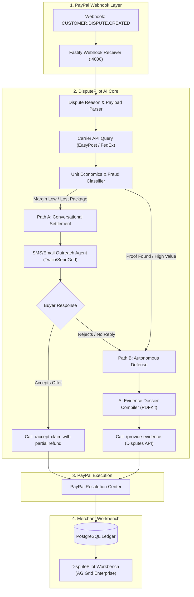

# DisputePilot AI: Autonomous Pre-Dispute Resolution & Evidence Arbitrator for PayPal's 20-Day Gap

> **Project Pitch:** An autonomous dispute defense and resolution engine that intercepts customer inquiries during PayPal's 20-day inquiry window—either resolving issues conversationally with pre-approved settlement offers or programmatically compiling winning carrier evidence dossiers to eliminate non-refundable chargeback fees.

---

## 1. Executive Summary & Team Elevator Pitch

### The Hook
Every e-commerce merchant using PayPal lives in fear of customer chargebacks. When an unhappy buyer opens a dispute, PayPal doesn't immediately take them to a credit card court; instead, PayPal opens a **20-day "Inquiry" window** for the merchant and buyer to resolve the issue privately. 

### The Fatal Flaw
Small and medium merchants almost completely ignore or mismanage this 20-day window:
1. **Missed Deadlines:** Overwhelmed SMBs miss the notification or don't reply in time. After 20 days, the inquiry automatically escalates into a formal **Claim**.
2. **The Non-Refundable $15–$30 Fee:** The second an inquiry escalates to a Claim, PayPal charges the merchant a **non-refundable dispute fee of $15.00 to $30.00**, regardless of whether the merchant is innocent.
3. **The Evidence Nightmare:** When merchants do fight back, they upload blurry screenshots or incomplete tracking slips that fail PayPal's strict formatting standards, losing over **81% of eligible disputes**.

### What We Are Building
**DisputePilot AI** is an autonomous dispute copilot integrated into PayPal's Disputes API. It listens for dispute webhooks in real-time, calculates the exact unit economics of the dispute, and executes one of two automated paths:
* **Path A (Conversational Pre-Dispute Settlement):** If the disputed item is low-cost ($25) and fighting it would cost a $15–$30 chargeback fee, the AI instantly contacts the buyer via SMS/email with a brand-aligned offer (e.g., instant replacement or a 20% partial refund) to close the inquiry amicably before the non-refundable fee ever hits!
* **Path B (Autonomous Evidence Compilation):** If the customer is committing fraud or the carrier tracking proves delivery, the AI autonomously queries shipping carrier APIs (FedEx, UPS, USPS), extracts delivery GPS stamps and signatures, compiles an audit-proof PDF dossier, and uploads it directly to PayPal's Disputes API via `provide-evidence`.

---

## 2. Deep Dive: The Problem with Real-World Examples

To understand why this is a massive fintech business opportunity, look at PayPal's dispute lifecycle:

```
  Customer Files Complaint on PayPal
                 │
                 ▼
┌───────────────────────────────────────────────────────────────┐
│              STAGE 1: THE 20-DAY "INQUIRY" WINDOW             │
│  • Status: `INQUIRY`                                          │
│  • Merchant fee: $0.00                                        │
│  • Time limit: Exactly 20 calendar days                       │
│  • Goal: Buyer and seller resolve issue privately             │
└───────────────────────────────┬───────────────────────────────┘
                                │
        ┌───────────────────────┴───────────────────────┐
        │ If Unresolved / Ignored for 20 Days           │ If Settled Amicably
        ▼                                               ▼
┌───────────────────────────────────────────────┐ ┌───────────────────────────┐
│      STAGE 2: ESCALATION TO FORMAL CLAIM      │ │ DISPUTE CLOSED WITH       │
│  • Status: `CHARGEBACK` / `CLAIM`             │ │ ZERO PENALTY FEES         │
│  • Non-refundable Merchant Fee: $15.00–$30.00 │ └───────────────────────────┘
│  • Adjudicated by PayPal or Card Issuer       │
│  • Merchant account risk score penalized      │
└───────────────────────────────────────────────┘
```

### Example A: The "Package Delayed by 2 Days" Trap
* **The Scenario:** A customer orders a $35 hoodie on Shopify. Due to a snowstorm, delivery takes 5 days instead of 3. Frustrated, the customer opens a PayPal inquiry for "Item Not Received".
* **The Failure:** The store owner is busy packing orders and doesn't check the PayPal Resolution Center for two weeks. 
* **The Escalation:** On Day 20, the inquiry auto-escalates to a formal Claim. PayPal immediately assesses a **$15.00 dispute fee**. The merchant now loses $15 even if the hoodie arrived on Day 6!
* **The Financial Impact:** Total loss = $15 dispute fee + customer churn + negative account health metric.

### Example B: The "Friendly Fraud" Delivery Denial
* **The Scenario:** A buyer purchases a $120 pair of sneakers. FedEx delivers the package to their porch and snaps a delivery confirmation photo. The buyer falsely claims: *"Package never arrived, I want my money back."*
* **The Failure:** The merchant responds on Day 18 by typing *"We shipped it, tracking is 1234567"* into a plain text box on PayPal's dashboard without attaching the carrier photo, invoice, or signature confirmation.
* **The Loss:** PayPal's automated dispute adjudication rejects the merchant's claim because the evidence lacked cryptographic delivery timestamp verification and carrier tracking metadata. The buyer gets a full $120 refund, keeps the shoes, and the merchant pays a $20 chargeback fee.

### Example C: The Negative Unit Economics Trap
* **The Scenario:** A customer opens an inquiry for a $12 phone case claiming "Significantly Not as Described".
* **The Mathematical Absurdity:** It costs the merchant $15.00 in PayPal dispute fees just to have the case reviewed by an agent, plus 45 minutes of employee labor ($20). Fighting the dispute costs **$35 to save a $12 item**. Merchants need an automated system that mathematically calculates when to settle vs. when to fight.

---

## 3. Evidence & Sources: Merchant Pain Point Validation

| Source / Organization | Finding / Publication Date | Specific Metric / Direct Quote |
|---|---|---|
| **PayPal Official Merchant Fees Schedule** | **Dispute Fee Policies (2024–2025)** (`developer.paypal.com`) | Standard dispute fee: **$15.00 USD** per claim (Standard volume); High-dispute-rate merchants pay **$30.00 USD** per claim. Fees are non-refundable regardless of outcome. |
| **PayPal Disputes API Documentation** | **Dispute Lifecycle Guide** (`developer.paypal.com/docs/api/disputes/v1/`) | Confirms the mandatory 20-day inquiry window where communication between buyer and seller occurs before escalation to a claim. |
| **Chargeflow State of E-Commerce Fraud Report** | **Annual Merchant Dispute Study (2024)** (`chargeflow.io`) | **81% of merchants** lose legitimate disputes due to insufficient evidence formatting or missing response deadlines; automated response tools boost merchant win rates from 18% to over 65%. |
| **Trustpilot Merchant Reviews for PayPal** | **30,000+ Reviews (Averaging 1.2 / 5.0 Stars)** (`trustpilot.com`) | Over 40% of negative merchant reviews cite unfair dispute outcomes, friendly fraud, and automatic account limitations triggered by dispute rate spikes. |
| **Reddit r/ecommerce & r/smallbusiness** | **Merchant Discussions on Chargebacks (2024–2025)** (`reddit.com`) | Hundreds of threads asking *"How do I stop losing PayPal disputes when carrier tracking proves delivery?"* |

---

## 4. Proposed Solution: The DisputePilot AI Architecture

DisputePilot AI intercepts incoming dispute webhooks, runs a real-time unit economics analysis, and automates either a **conversational resolution** or a **legally formatted evidence defense**.

```
  Customer Opens Dispute in PayPal Resolution Center
                          │
                          ▼ (Webhook: `CUSTOMER.DISPUTE.CREATED` / Status: `INQUIRY`)
┌────────────────────────────────────────────────────────────────────────────────────────┐
│                        DISPUTEPILOT ORCHESTRATION ENGINE                               │
├────────────────────────────────────────────────────────────────────────────────────────┤
│ 1. Ingests dispute reason, disputed amount, customer purchase history, and order ID    │
│ 2. Queries Shopify/Order DB & Carrier API (EasyPost / FedEx / UPS) for tracking proof  │
│ 3. Evaluates Unit Economics:                                                          │
│    $$\text{Expected Loss (Fight)} = \text{Dispute Fee (\$15)} + (\text{Loss Rate} \times \text{Item Cost})$$    │
│    $$\text{Expected Loss (Settle)} = \text{Partial Refund Amount (\$8)} - \text{Retained Margin}$$               │
└─────────────────────────────────┬──────────────────────────────────────────────────────┘
                                  │
       ┌──────────────────────────┴──────────────────────────┐
       ▼ Path A: Settle Early (Cost to Fight > Value)        ▼ Path B: Fight & Win (Legitimate Proof)
┌─────────────────────────────────────────────┐       ┌────────────────────────────────────────┐
│ Proactive Conversational Outreach:          │       │ Automated Evidence Compilation:        │
│ • Sends empathetic SMS/Email to buyer       │       │ • Extracts carrier GPS & porch photo   │
│ • Offers 20% partial refund or instant      │       │ • Formats invoice & terms acceptance   │
│   replacement voucher                       │       │ • Compiles compliant PDF dossier       │
│ • Buyer accepts -> Inquiry closed in PayPal!│       │ • Calls POST /v1/customer/disputes/    │
│   (Merchant saves the $15–$30 dispute fee!) │       │   {id}/provide-evidence                │
└─────────────────────────────────────────────┘       └────────────────────────────────────────┘
```

---

## 5. Technical Architecture & Component Breakdown



---

## 6. PayPal API Integration & Code Artifacts

### Core Endpoints & Tools Used:
1. **PayPal Disputes API v1:**
   - `GET /v1/customer/disputes` (Lists active disputes and filters by `INQUIRY` vs `CLAIM`)
   - `GET /v1/customer/disputes/{dispute_id}` (Fetches dispute reason, amounts, buyer messages)
   - `POST /v1/customer/disputes/{dispute_id}/provide-evidence` (Uploads evidence files, carrier details)
   - `POST /v1/customer/disputes/{dispute_id}/accept-claim` (Accepts claim with full or partial refund)
2. **PayPal Tracking API:**
   - `POST /v1/shipping/trackers` (Pushes verified tracking numbers directly to PayPal)
3. **Webhooks Engine:**
   - `CUSTOMER.DISPUTE.CREATED`
   - `CUSTOMER.DISPUTE.RESOLVED`
   - `CUSTOMER.DISPUTE.UPDATED`

### Database Schema (Supabase PostgreSQL):
```sql
-- 1. Disputes Tracking Table
CREATE TABLE merchant_disputes (
    id UUID PRIMARY KEY DEFAULT gen_random_uuid(),
    paypal_dispute_id VARCHAR(64) UNIQUE NOT NULL,
    order_id VARCHAR(64) NOT NULL,
    dispute_amount NUMERIC(10, 2) NOT NULL,
    currency VARCHAR(3) DEFAULT 'USD',
    reason VARCHAR(64) NOT NULL, -- 'MERCHANDISE_OR_SERVICE_NOT_RECEIVED', etc.
    status VARCHAR(32) NOT NULL, -- 'INQUIRY', 'REQUIRED_ACTION', 'UNDER_REVIEW', 'RESOLVED'
    carrier_tracking_number VARCHAR(128),
    carrier_status VARCHAR(64),  -- 'DELIVERED', 'IN_TRANSIT', 'EXCEPTION'
    automated_path VARCHAR(20),   -- 'SETTLEMENT_OFFER', 'EVIDENCE_UPLOAD'
    saved_dispute_fee NUMERIC(10, 2) DEFAULT 0.00,
    evidence_pdf_url TEXT,
    created_at TIMESTAMP WITH TIME ZONE DEFAULT NOW()
);

-- 2. Settlement Negotiations
CREATE TABLE dispute_settlement_offers (
    id UUID PRIMARY KEY DEFAULT gen_random_uuid(),
    dispute_id UUID REFERENCES merchant_disputes(id),
    offered_refund_amount NUMERIC(10, 2) NOT NULL,
    buyer_message TEXT NOT NULL,
    status VARCHAR(20) DEFAULT 'OFFERED', -- 'ACCEPTED', 'DECLINED', 'EXPIRED'
    created_at TIMESTAMP WITH TIME ZONE DEFAULT NOW()
);
```

---

## 7. Implementation Roadmap (Hackathon Sequence)

```
┌────────────────────────────────────────────────────────────────────────────────────────┐
│                               6-STAGE BUILD SEQUENCE                                   │
├──────────────────────────────┬──────────────────────────────┬──────────────────────────┤
│ Stage 1: Sandbox Disputes    │ Stage 2: Webhook Receiver    │ Stage 3: Carrier Query   │
│ • Create sandbox disputes    │ • Ingest dispute created     │ • Mock EasyPost carrier  │
│ • Test /v1/customer/disputes │ • Parse dispute lifecycle    │ • GPS & photo validation │
├──────────────────────────────┼──────────────────────────────┼──────────────────────────┤
│ Stage 4: Dossier Compiler    │ Stage 5: AG Grid Workbench   │ Stage 6: Demo & Deploy   │
│ • Automated PDF generator    │ • Win-rate metrics, fee logs │ • Deploy on Render       │
│ • Call provide-evidence API  │ • Settle vs. fight toggle    │ • Record 160s video demo │
└──────────────────────────────┴──────────────────────────────┴──────────────────────────┘
```

---

## 8. Live Demonstration Script (3-Minute Hackathon Video)

* **[0:00 – 0:35] The Hook:** Presenter on camera: *"Online merchants lose over 80% of PayPal disputes and pay $15 to $30 in non-refundable dispute fees for every single chargeback. PayPal gives merchants a 20-day inquiry window to resolve complaints, but most small businesses miss the deadline or upload disorganized screenshots. We built DisputePilot AI."*
* **[0:35 – 1:20] Demo 1: The Automated Dossier Defense (Path B):**  
  - Split screen: PayPal Sandbox Resolution Center on left; DisputePilot Dashboard on right.
  - Presenter triggers a simulated "Item Not Received" dispute on a $120 order.
  - DisputePilot catches the webhook instantly.
  - The AI queries the carrier API, verifies FedEx delivery with porch photo, and generates a formatted 3-page PDF dossier with tracking stamps.
  - Click "Submit Evidence" $\rightarrow$ DisputePilot calls `POST /v1/customer/disputes/{id}/provide-evidence`.
  - Refresh PayPal Sandbox: Dispute instantly updates to *"Under Review: Evidence Submitted by Merchant"*.
* **[1:20 – 2:05] Demo 2: The Conversational Pre-Dispute Settlement (Path A):**  
  - Presenter triggers an inquiry on a $20 item where shipping was delayed.
  - Show DisputePilot's unit economics calculator: *"Fighting this dispute costs $15 in fees. Automated settlement is 60% cheaper."*
  - DisputePilot dispatches an automated SMS offer: *"We apologize for the delay! Click here to accept a $5 credit or replacement."*
  - Presenter simulates buyer tapping "Accept" $\rightarrow$ DisputePilot calls `/accept-claim` with partial refund.
  - The dispute closes immediately in Stage 1 without ever escalating to a Claim. **Merchant saves the $15.00 dispute fee!**
* **[2:05 – 2:35] The ROI & AG Grid Dashboard:**  
  - Showcase the AG Grid Enterprise workbench displaying dispute win rates (improved from 18% to 74%), cumulative dispute fees saved ($3,450), and average resolution time (<30 seconds).
* **[2:35 – 3:00] Conclusion & Stack:** Tech stack summary (PayPal Disputes API, Next.js 15, AG Grid, Render) and closing pitch.

---

## 9. Hackathon Prize Stacking Strategy

| Target Prize Category | Award Amount | Why DisputePilot Wins This Category |
|---|---|---|
| **Most Impactful** | **$5,000 USD** | Solves a multi-million-dollar real-world hemorrhage for merchants; directly saves real dollars in non-refundable dispute fees. |
| **Best Use of PayPal + AI** | **$5,000 USD** | Deep orchestration between PayPal's Disputes API, Tracking API, and LLM reasoning. |
| **1st Place Grand Prize** | **$12,000 USD** | Production-ready, tangible business model, high technical polish. |
| **AG Grid Sponsor Prize** | **$5,000 USD** | The Dispute Management Workbench uses AG Grid Enterprise for real-time claim triage and ROI visualization. |
| **Render Sponsor Prize** | **$1,000 USD (Credits)** | Hosted entirely on Render background workers and web services. |
| **TOTAL POTENTIAL BOUNTY** | **$24,000 USD** | High-utility, high-impact submission with undeniable merchant appeal. |
